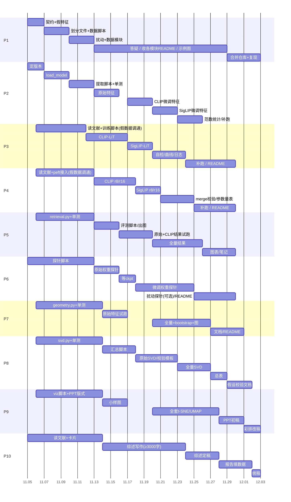

# 项目一第二组 实验分工表（11.5 – 12.3）

内部使用版。认领在共享表格里填，下面每个人的任务、输入、输出、验收标准、DDL 都写在这里。数据集和权重体积不大，各人自行下载，不走 U 盘，下载不进甘特图，但需要用到的人要在 11.9 前下完。

## 一、实验概要

加载 CLIP 与 SigLIP 两个公开预训练模型，不做预训练，只做下游微调。三种处理：

| 处理 | 做法 |
|---|---|
| pretrained | 原始权重，不微调 |
| LiT | 冻结图像编码器，只微调文本分支，AdamW，lr 1e-4 |
| LoRA | 图像、文本两个 Transformer 的注意力层挂 LoRA，r=8 和 r=16 各一组，AdamW，lr 5e-4 |

再对图像加两种扰动：高斯噪声、随机矩形遮挡（Random Erasing 风格）。然后测量图文共享嵌入空间的变化：对齐、均匀性、模态间隙、类别原型距离、SVD 奇异值谱、微调后嵌入与原始嵌入的余弦相似度，另外配检索 Recall@1/5/10 和 CIFAR-100 线性探针作为参照。重点是解释表征变化，不是追求指标。

规模：2 个模型 × 4 种设置（pretrained / lit / lora_r8 / lora_r16）× 3 种主输入（clean / noise / occl）。噪声和遮挡另外各加弱、强两档，仅在 Flickr val 上做，见 3.6。真正要训练的只有 6 次：LiT 2 次，LoRA 4 次。

最终交四样：文献综述（≥3000 字，引用全部本组文献）、15 分钟 PPT、可运行代码工程（含 README）、实验假设校验文档。

## 二、待确认事项（会影响所有人，暂按默认值做）

| 编号 | 问题 | 当前默认 | 如果改了 |
|---|---|---|---|
| Q1 | 模型与输入尺寸 | 已与老师确认：CLIP `openai/clip-vit-base-patch32`（224×224）对 SigLIP2 `google/siglip2-base-patch32-256`（256×256），两个模型各用自己的分辨率。不再讨论，见 3.4 的分辨率说明 | 已定，不改 |
| Q2 | 指导书里的 “Flickr30K-CLIP 子集 / COCO-CLIP 子集”，是老师有现成的子集文件，还是自己从原数据集抽 | 自己抽 | 有现成文件则 P1 改用，划分规则以老师为准 |
| Q3 | 指导书没规定训练 epoch、batch、噪声强度、遮挡大小 | 见第三节 | 改了在 11.7 前通知，之后冻结 |
| Q4 | 同一张图有 5 条文本，对齐、均匀性这类一一对应的指标用哪条 | 每张图固定用第 1 条 | 不变 |
| Q5 | 噪声、遮挡下的“微调后与原始嵌入相似度”怎么算 | 两种都算：同条件下对比 pretrained；以及 pretrained 的 clean 对 noise/occl | 不变 |
| Q6 | 类别原型 | 只用 COCO 与 CIFAR-100，Flickr30K 没有类别，不算原型 | 不变 |
| Q7 | 参考文献里有 2026 年的论文（CVPR-2026、arXiv 2026） | P10 先核实能否找到 | 找不到的向老师要 PDF |
| Q8 | 显卡：P2、P3、P4、P6 需要 ≥10GB 显存的卡，谁有卡 | 组内先统计一下 | 没有卡的用 Colab / Kaggle / 学校机房，P3、P4 优先 |

## 三、统一约定（11.7 前有意见在群里提，之后冻结）

### 3.1 环境

Python 3.10，CUDA 12.1（驱动 ≥ 525）。

```
conda create -n mmrep python=3.10 -y
conda activate mmrep
pip install torch==2.4.1 torchvision==0.19.1 --index-url https://download.pytorch.org/whl/cu121
pip install transformers==4.49.0 peft==0.14.0 accelerate==1.2.1 sentencepiece==0.2.0 protobuf safetensors numpy==1.26.4 scikit-learn==1.5.2 umap-learn==0.5.7 pandas==2.2.3 matplotlib==3.9.2 seaborn==0.13.2 openpyxl==3.1.5 pillow tqdm pyyaml
```

用 uv 的话（和上面的 conda 二选一，装的版本完全一样）：

```
# 安装 uv：macOS / Linux
curl -LsSf https://astral.sh/uv/install.sh | sh
# 安装 uv：Windows PowerShell
powershell -ExecutionPolicy ByPass -c "irm https://astral.sh/uv/install.ps1 | iex"
# 或者已有 pip：pip install uv

uv venv --python 3.10 .venv
source .venv/bin/activate          # Windows：.venv\Scripts\activate
uv pip install torch==2.4.1 torchvision==0.19.1 --index-url https://download.pytorch.org/whl/cu121
uv pip install transformers==4.49.0 peft==0.14.0 accelerate==1.2.1 sentencepiece==0.2.0 protobuf safetensors numpy==1.26.4 scikit-learn==1.5.2 umap-learn==0.5.7 pandas==2.2.3 matplotlib==3.9.2 seaborn==0.13.2 openpyxl==3.1.5 pillow tqdm pyyaml
```

- 两条 `uv pip install` 要分开执行，顺序不能反：torch 那条指定了 PyTorch 的源，其余库走默认的 PyPI；合成一条的话 uv 会因为两个源的包版本冲突报错或装错版本
- 国内网络慢的话，第二条加 `--index-url https://pypi.tuna.tsinghua.edu.cn/simple`（torch 那条不要加，PyTorch 的包只在官方源上）
- 装完验证：`python -c "import torch;print(torch.__version__, torch.cuda.is_available())"`，应显示 `2.4.1+cu121 True`
- 我在沙箱里只做了解析检查（`--dry-run`），确认上面几个版本能解析出一致的依赖集合，没有在带显卡的机器上实际安装并跑通，有报错请反馈
- uv 的虚拟环境放在项目目录的 `.venv` 里，`.venv` 要加进 `.gitignore`，不要提交

- 没有显卡的人（P1、P5、P7、P8、P9、P10）把 torch 那行的链接换成 `https://download.pytorch.org/whl/cpu`，版本号不变
- 驱动较老的人把链接里的 cu121 换成 cu118
- 例外：RTX 50 系列（Blackwell）显卡，torch 2.4.1 不支持，这类卡把 torch 那行换成 `pip install torch==2.7.1 torchvision==0.22.1 --index-url https://download.pytorch.org/whl/cu128`，其余库版本不变；换了的人在群里说一声，特征与结果不受影响
- 为什么是这些版本：SigLIP2 需要 transformers ≥ 4.49，torch 2.4.1 与 numpy 1.26.4 搭配最稳，peft 0.14.0 与这版 transformers 配套。指导书写的 PyTorch ≥1.12 太旧

### 3.2 数据集与权重

| 内容 | 来源 | 大小 | 谁下载 |
|---|---|---|---|
| Flickr30K 图片包 `flickr30k-images.zip` 与标注 `flickr_annotations_30k.csv` | HuggingFace `nlphuji/flickr30k` | 约 4.4GB | P1、P2、P3、P4 |
| COCO val2017 图片 `val2017.zip` | `http://images.cocodataset.org/zips/val2017.zip` | 约 0.8GB | P1、P2 |
| COCO 标注 `annotations_trainval2017.zip` | `http://images.cocodataset.org/annotations/annotations_trainval2017.zip` | 约 0.25GB | P1、P2、P7 |
| CIFAR-100 | torchvision 自动下载 | 约 0.17GB | P1、P6 |
| CLIP B/32 | HF `openai/clip-vit-base-patch32` | 约 0.6GB | P2、P3、P4、P6 |
| SigLIP2 B/32 | HF `google/siglip2-base-patch32-256` | 约 1.5GB | P2、P3、P4、P6 |

- P3、P4 训练只用 Flickr 的 train 部分，但原始文件要整包下载；P3、P4 不需要 COCO
- P5、P7、P8、P9、P10 不需要任何原始数据和权重，只用特征文件和 csv（P7 额外要 COCO 的类别标签文件，P1 会提供）
- HF 下载慢的话：`export HF_ENDPOINT=https://hf-mirror.com`
- 特征文件、checkpoint、csv 体积不大（全部特征约 1GB，LiT 的 SigLIP checkpoint 约 1.1GB，LoRA 几十 MB），用群文件或网盘传

### 3.3 数据划分（种子 42，P1 产出，各人不要自己另划）

- Flickr30K：从标注文件里的 31014 张（caption 都满 5 条）中抽 10000 张，train 8000 / val 1000 / test 1000，每张 5 条 caption
- COCO：只用 val2017，其中有实例标注且 caption ≥5 条的是 4952 张（另外 48 张没有实例，没法确定类别，剔除），val 2476 / test 2476，不用于训练（实测类别很不均衡：val 里实际出现 68 类，person 占 32%，样本数 ≥20 的只有 37 类；算类别原型时只统计样本数 ≥20 的类，见 P7），用来调脚本和算类别原型；每张图的类别取面积最大的实例所属类别
- CIFAR-100：官方 train 5 万 / test 1 万
- 指标以 val 为主，test 作复核
- 划分文件 `splits/flickr_split.json`、`splits/coco_split.json`：`{"seed":42, "train":[id...], "val":[id...], "test":[id...], "captions":{id:[5 条文本]}, "labels":{id:int}}`（Flickr 的 labels 全为 -1）；`id` 是图片文件名；P1 提供 `data/prepare_data.py`，各人下完原始数据后运行它建立本地的图片索引

### 3.4 模型与输入

- 统一用 HuggingFace transformers：CLIP 用 `CLIPModel`，SigLIP2 用 `SiglipModel`，两者都有 `get_image_features`、`get_text_features`，输出为未归一化的嵌入
- 输入尺寸与 mean/std 写在 `configs/models.yaml`，所有人从这里读，不要写死：CLIP 为 224，SigLIP2 为 256；CLIP 使用 OpenAI 官方 mean/std，SigLIP2 为 mean=std=0.5
- 文本：CLIP 用 `CLIPTokenizer`（max_length 77）；SigLIP2 的 tokenizer 先把文本转小写，padding="max_length"，max_length=64
- 嵌入维度：CLIP 512，SigLIP2 768。几何指标只在同一个模型内部比较，不跨模型直接比向量

分辨率说明（两个模型输入尺寸不同，全组都要知道）：
- CLIP：224×224，7×7=49 个 patch；SigLIP2：256×256，8×8=64 个 patch；两者 patch 都是 32×32 像素，所以单个 patch 内的像素数一样
- 同一张原图要分别预处理成两个尺寸，不要共用一份张量，也不要把一个模型的缓存给另一个模型用。`get_dataset(..., model)` 按 `model` 取各自的尺寸，P1 负责保证这点
- 预处理方式以各模型官方处理器为准，写进 `configs/models.yaml`：CLIP 是“短边缩放到 224（双三次）再中心裁剪”，SigLIP2 是“直接缩放到 256×256（双线性，不保持长宽比、不裁剪）”。这两种处理在非正方形图上会让两边看到的画面不完全一样（CLIP 会裁掉左右或上下边缘，SigLIP2 会拉伸），属于已知差异，写进报告的局限里，不要试图在代码里统一
- 所有尺寸相关的数值（遮挡矩形尺寸、CIFAR 的放大尺寸、可视化的输入）都从 `models.yaml` 读，代码里不允许出现写死的 224 或 256
- 跨模型比较只比“相对变化”（例如 noise 相对 clean 的 Recall 降幅、间隙增幅），不直接比较两个模型的绝对数值，原因见 `docs/resolution_note.md`（P10 汇总）

### 3.5 训练设置（P3 与 P4 必须一致，只有微调方式不同）

| 项 | 值 |
|---|---|
| 训练集 | Flickr train 8000，每个 epoch 每张图随机取 1 条 caption（`torch.Generator` 种子 42） |
| epoch / batch | 5 epoch，batch 128（OOM 时开 gradient checkpointing，仍不行再降到 64 并在 meta.json 注明） |
| 优化器 | AdamW，weight decay 0.01，betas 默认；LiT lr 1e-4，LoRA lr 5e-4 |
| 学习率策略 | 5% warmup，之后 cosine 衰减到 0 |
| 精度 | fp16 autocast + GradScaler；LoRA 参数保持 fp32 |
| 损失 | 沿用原模型的损失：CLIP 用对称 InfoNCE；SigLIP 用 sigmoid loss（见 `train/losses.py`） |
| logit_scale / logit_bias | 冻结在预训练值，不参与训练（保证改变的只是表征） |
| 保存 | 最后一个 epoch，不按指标挑最优 |
| LiT 可训练范围 | 文本塔 `text_model` 全部 + 文本投影（CLIP 的 `text_projection`）；图像塔 `vision_model` 与 `visual_projection` 全部冻结 |
| LoRA 目标模块 | 正则 `.*(vision_model|text_model).*\.(q_proj|k_proj|v_proj|out_proj)`，alpha = 2r，dropout 0.05，bias="none" |
| 种子 | 42 |

`train/losses.py` 里的函数（P3 写）：
- `info_nce(img, txt, logit_scale)`：img、txt 已 L2 归一化，`logits = exp(logit_scale) * img @ txt.T`，对角为正样本，行方向与列方向的交叉熵取平均
- `sigmoid_loss(img, txt, logit_scale, logit_bias)`：`logits = exp(logit_scale) * img @ txt.T + logit_bias`，标签矩阵 `2*eye(B)-1`，loss = `-sum(logsigmoid(标签 * logits)) / B`

### 3.6 扰动（P1 实现）

- 在 [0,1] 像素空间做，顺序固定：resize 到模型输入尺寸，再加扰动，再归一化
- 噪声：加 N(0, σ²)，clip 到 [0,1]，σ 见下表
- 强度分三档（主设置是中档，所有数据集、所有分析都用中档；弱、强两档只在 Flickr val 上跑，用来看“扰动越强，间隙和对齐变化是否越大”）：

| cond 名 | 噪声 σ | 遮挡面积占整图比例 | 说明 |
|---|---|---|---|
| `noise_lo` / `occl_lo` | 0.05 | 10% | 弱 |
| `noise` / `occl`（主设置） | 0.1 | 25% | 中，所有数据集、所有分析都用这一档 |
| `noise_hi` / `occl_hi` | 0.2 | 50% | 强 |

- 遮挡：Random Erasing 风格的 1 个随机矩形（Zhong et al., AAAI 2020）：面积 = 表中比例 × 整图面积；长宽比 w/h 在 [0.3, 3.3] 内对数均匀随机（每个样本不同，所以不是固定正方形）；位置完全随机；矩形若超出画面，会把长边截到画面边界并放宽另一边以保持面积；填充值是该模型的均值像素（CLIP 为 OpenAI 的 mean，SigLIP2 为 0.5），即归一化后恰好为 0，与 Cutout / Random Erasing 的“均值填充”一致，不是纯黑。纯黑会引入额外的强对比边缘，让“遮挡”与“出现一块黑色异物”两个因素混在一起
- 遮挡的形状和位置用相对坐标：先用种子抽 `(r, u, v)`（长宽比、位置），相对高 = √(面积/r)，相对宽 = √(面积×r)，左上角 = `round(u × (H − 高))`、`round(v × (W − 宽))`，这样同一个样本在两个模型里遮挡的是原图的同一块区域（取整误差内）。三档遮挡共用同一组 `(r, u, v)`，只有面积不同
- 噪声：每个模型在自己的分辨率上生成（形状不同，没法逐像素相同），种子相同；σ 都是 0.1，两边每个 patch 内像素数相同，所以每个 patch 受到的噪声强度一致
- 随机数：`torch.Generator().manual_seed(42 + 样本序号)`，同一样本在同一个模型的所有设置下得到完全相同的扰动；跨模型只保证遮挡区域相同，噪声是同分布的不同实例
- 在线生成，不存盘；同一样本一次给出 clean/noise/occl 三份，一一对应；弱、强档同理，同一样本、同一种子，只改强度，位置与随机数不变（遮挡的长宽比和位置一致、噪声同一个标准正态场乘不同 σ），保证强度之间只有强度这一个变量

### 3.7 特征文件格式（P2 产出）

路径：`features/{model}/{setting}/{dataset}_{split}_{cond}.npz`

| 取值 | 范围 |
|---|---|
| model | `clip`、`siglip` |
| setting | `pretrained`、`lit`、`lora_r8`、`lora_r16` |
| dataset | `flickr`、`coco` |
| split | `val`、`test` |
| cond | `clean`、`noise`、`occl`（主设置，所有数据集 split 都有）；`noise_lo`、`noise_hi`、`occl_lo`、`occl_hi`（只有 `flickr_val`） |

字段：
- `img_raw`：float32 `[N, D]`，未归一化的图像嵌入，需要时自己做 L2 归一化
- `img_ids`：长度 N 的字符串数组，顺序与划分文件里该 split 的 id 顺序一致；所有文件相同
- clean 文件额外含：`txt_raw` float32 `[5N, D]`，排列为 `txt_raw[5*i + j]` 是第 i 张图的第 j 条 caption；`txt2img` int64 `[5N]`，等于 `i`
- noise、occl 及其弱、强档文件只有图像字段（文本不受图像扰动影响，不重复存）
- COCO 文件额外含：`labels` int64 `[N]`

CIFAR-100：`features_cifar/{model}/{setting}/{train|test}.npz`，含 `img_raw`（float16）和 `labels`；另有 `features_cifar/{model}/{setting}/class_txt.npz`，含 100 条 “a photo of a {类名}” 的文本嵌入 `txt_raw [100, D]`

### 3.8 checkpoint 格式（P3、P4 产出，P2、P6 读取）

- LiT：`ckpt/{model}/lit/trainable_state.pt`：`dict[param_name -> tensor]`，只含 requires_grad 的参数；加载用 `model.load_state_dict(sd, strict=False)`
- LoRA：`ckpt/{model}/lora_r8/adapter/`、`ckpt/{model}/lora_r16/adapter/`：peft 的 `save_pretrained` 目录；加载用 `PeftModel.from_pretrained(base, path)` 后 `merge_and_unload()`
- 每个目录里放 `meta.json`：lr、epoch、batch、种子、可训练参数量、总耗时（秒）、峰值显存（MB）、每个 epoch 的 loss

### 3.9 函数接口

| 接口 | 约定 |
|---|---|
| `load_model(model, setting, ckpt_root="ckpt", device="cuda")`（P2，`models/loader.py`） | 返回 `ModelWrapper`，属性：`embed_dim`、`input_size`、`mean`、`std`；方法：`tokenize(list[str]) -> dict`、`encode_image(pixel_values) -> Tensor[B,D]`、`encode_text(**tokens) -> Tensor[B,D]`，输出均为未归一化；`model` 取 `clip/siglip`，`setting` 取 `pretrained/lit/lora_r8/lora_r16` |
| `get_dataset(name, split, cond, model)`（P1，`data/datasets.py`） | `name` 取 `flickr/coco/cifar100`；每项是 dict：`image`（按 `model` 对应的尺寸与官方预处理 resize、扰动、归一化后的 Tensor，CLIP 为 `[3,224,224]`，SigLIP2 为 `[3,256,256]`）、`captions`（list[str]，CIFAR 为空）、`idx`、`id`、`label`；同时提供 `collate_fn` |
| `perturb(img01, mode, idx, seed=None, fill=None)`（P1，`data/perturb.py`；用法 `from data.perturb import perturb`，不要写 `from data import perturb`） | `img01` 为 `[3,H,W]`、取值 [0,1]；`mode` 取 `clean/noise/noise_lo/noise_hi/occl/occl_lo/occl_hi`，`fill` 是遮挡填充的 RGB（[0,1] 空间），`get_dataset` 会自动传该模型的 mean，其他人直接用 `get_dataset` 即可；返回同形状 |
| `Logger`（P1，`tools/logger.py`） | 记录耗时和 `torch.cuda.max_memory_allocated`，写入 `logs/` |

没有真实数据时，所有人用 P1 的 `tools/make_dummy_features.py`（造满足 3.7 格式的假特征）开发。

### 3.10 其他选项（已采用的与备选）

| 项目 | 已采用 | 备选 |
|---|---|---|
| Flickr 子集大小 | 10000 张 | 6000 张（4000/1000/1000），显卡慢时 |
| 训练轮数 | 5 epoch | 3 epoch |
| 噪声强度 | 三档 0.05 / 0.1 / 0.2（只有 Flickr val 跑三档，其余只用 0.1） | 只用 0.1，去掉强度这一维 |
| 遮挡面积 | 三档 10% / 25% / 50%（同上） | 只用 25% |
| 模态间隙主指标 | 图文质心距离 | MMD |
| 线性探针 | PyTorch 单层 Linear | sklearn LogisticRegression |
| 降维采样 | 1000 张图 | 500 张 |
| 特征格式 | npz | torch.save 的 pt |

## 四、认领表

| 编号 | 内容 | 要显卡 | 工作量 |
|---|---|---|---|
| P1 | 数据划分、扰动、约定文件、仓库与总 README | 否 | 前期集中，后期轻 |
| P2 | 模型加载、特征提取、范数统计 | 是 | 中 |
| P3 | LiT 微调 | 是 | 中 |
| P4 | LoRA 微调（r=8、r=16） | 是 | 中偏重 |
| P5 | 检索评测、嵌入漂移 | 否 | 中 |
| P6 | CIFAR-100 线性探针 | 是（较轻） | 中偏轻 |
| P7 | 对齐、均匀性、模态间隙、类别原型 | 否 | 中 |
| P8 | SVD、汇总总表、假设校验文档 | 否 | 中偏重 |
| P9 | t-SNE/UMAP、课堂汇报 PPT | 否 | 中偏重 |
| P10 | 文献综述、实验报告 | 否 | 中偏重，文字多 |

## 五、每个人的任务

仓库目录（P1 建好）：

```
mmrep/
  configs/      models.yaml  lit.yaml  lora.yaml  perturb.yaml
  splits/       flickr_split.json  coco_split.json  cifar100_classes.json
  data/         prepare_data.py  datasets.py  perturb.py
  models/       loader.py
  train/        losses.py  train_lit.py  train_lora.py
  extract/      extract_features.py  extract_cifar.py
  eval/         retrieval.py  eval_retrieval.py  drift.py  probe_cifar100.py
  metrics/      geometry.py
  analysis/     svd.py  build_summary.py
  viz/          tsne_umap.py
  tools/        make_dummy_features.py  logger.py
  tests/
  features/  features_cifar/  ckpt/  results/  logs/  docs/
```

### P1 数据划分、扰动、约定文件、仓库

DDL 总览：11.6 约定文件；11.9 划分文件与数据脚本；11.12 扰动与数据模块；11.29 收 README；12.2 合并仓库。

任务：
1. 11.5–11.6：建仓库和目录；写 `docs/CONTRACT.md`，内容整理自本文第三节；写 `configs/models.yaml`（两个模型的名字、输入尺寸、mean/std、tokenizer 参数）；11.6 把文件发群里
2. 11.5–11.6：写 `tools/make_dummy_features.py`：按 3.7 的格式，对 2 个模型 × 4 设置 × 2 数据集 × 2 split × 3 条件各生成一份假特征，图文之间加一点弱相关结构，使指标能算出有意义的数；N 取 200 即可；写 `tools/logger.py`
3. 11.7–11.9：自己下载 Flickr30K、COCO val2017（含标注）、CIFAR-100；写 `data/prepare_data.py`（命令见仓库 README）：Flickr 随机抽 10000 张（种子 42），划分 8000/1000/1000，每张保存前 5 条 caption；COCO 从 val2017 的 5000 张按 2500/2500 划分，类别标签取面积最大的实例所属类别（用 `annotations/instances_val2017.json`），captions 取前 5 条；CIFAR-100 导出类别名列表 `cifar100_classes.json`；输出 `splits/*.json`（格式见 3.3）。11.9 把划分文件和脚本发群里，别人下完原始数据后用脚本建本地索引
4. 11.10–11.12：写 `data/perturb.py` 与 `data/datasets.py`（接口见 3.9）；写 `tests/test_data.py`：train/val/test 的 id 两两无交集；同一 idx 两次调用 `perturb` 结果逐位相同；同一样本 clean/noise/occl 三份一一对应、形状一致；对 CLIP 与 SigLIP2 各测一遍，断言输出形状分别为 `[3,224,224]` 与 `[3,256,256]`，遮挡矩形的面积比、长宽比范围、填充值（归一化后为 0）符合 3.6，两个模型里同一个 idx 的遮挡区域在原图上的相对位置一致（误差不超过边长的 2%）；这些测试 P1 已经写好放在仓库 `tests/test_data.py`，直接沿用即可；预处理按各模型官方处理器实现，并把 CLIP 的“短边缩放加中心裁剪”与 SigLIP2 的“直接缩放到方形”写进 `models.yaml`；`perturb` 还要支持 `noise_lo/noise_hi/occl_lo/occl_hi`，测试：同一样本三档的遮挡长宽比和位置一致且面积递增、噪声场只差一个 σ 倍数；输出 PNG 示例图（同一批 8 张图，每张展示 clean 与三档噪声、三档遮挡共 7 列，放 `docs/perturb_examples.png`，PPT 用）
5. 11.13–11.28：回答大家的接口问题；每个交接日期晚上（第六节）在群里确认交付情况，没交的问新时间；11.29 前收齐各模块 README
6. 11.29–12.2：合并仓库和总 README（环境安装、运行顺序、各模块 README 链接）；找一台干净环境按 README 从头跑一遍，记录哪里报错，12.2 前修完

需要别人给：11.29 前各模块 README。
交给别人：11.6 约定文件、假特征脚本、日志函数、`models.yaml`（全员）；11.9 划分文件与 `prepare_data.py`（P2、P3、P4、P6、P7）；11.10 `perturb`（P2、P6）；11.12 数据模块（P2、P3、P4、P6）。
最终交付：划分索引文件、数据模块与扰动模块（含测试）、CONTRACT.md、示例图、总 README 与整合后的代码仓库。
验收：三个 split 互不重叠；同种子两次扰动逐位一致；`prepare_data.py` 两次运行得到的划分文件逐字节一致。

### P2 模型加载与特征提取

DDL 总览：11.9 `load_model` 初版；11.12 提取脚本与单批测试；11.15 pretrained 特征；11.19 CLIP 全部特征；11.22 SigLIP 全部特征；11.25 范数统计。

任务：
1. 11.5–11.6：下载 CLIP 与 SigLIP2 权重，加载一个 batch，确认嵌入维度、输入尺寸、tokenizer 行为；写 `docs/model_notes.md`（记录输出维度、是否需要小写与固定 padding、logit_scale/logit_bias 在哪里取）
2. 11.7–11.9：写 `models/loader.py`：`load_model(model, setting, ckpt_root, device)`。pretrained 直接 `from_pretrained`；lit 读 `trainable_state.pt` 并 `load_state_dict(strict=False)`；lora 读 adapter 目录，`PeftModel.from_pretrained` 后 `merge_and_unload()`。先完成 pretrained，lit 与 lora 先写好代码，待 checkpoint 到位再测
3. 11.10–11.12：写 `extract/extract_features.py`，参数 `--model --setting --dataset --split --cond`（可用 `all` 表示主设置全部；弱、强档用 `--cond strength`，只对 `flickr val` 生效），逻辑：从 `get_dataset` 取数据，`torch.no_grad` + fp16 推理，CLIP batch 256，SigLIP2 因为 token 多约 30%、batch 取 192（显存不够再降）；图像尺寸不要写死，从 `models.yaml` 读；文本一次性按 5 条 caption 展开成 `txt_raw[5i+j]`；输出按 3.7 保存；已存在的文件默认跳过（断点续跑）；写 `tests/test_extract_one_batch.py`：取 1 个 batch，断言图像嵌入形状为 `[B, D]`、文本嵌入形状为 `[B, D]`、D 等于配置里的 `embed_dim`、无 NaN、同一输入两次结果相同、归一化后范数为 1（指导书要求的交付项）
4. 11.13–11.15：提取 pretrained 的特征（2 模型 × 2 数据集 × 2 split × 3 条件）；写 `run_extract_all.sh`，checkpoint 到位后一条命令跑完
5. 11.17–11.19：CLIP 的 lit、lora_r8、lora_r16 特征；11.20–11.22：SigLIP 的三组特征。每提取完一个模型的一批立即通知 P5、P7、P8、P9
6. 11.23–11.25：范数统计：对每个文件的 `img_raw` 与 `txt_raw` 算范数的均值、标准差、5/50/95 分位数，输出 `results/norm_stats.csv`（列：model, setting, cond, dataset, split, modality, mean, std, p5, p50, p95），并画范数分布直方图；校验：lit 的图像特征与 pretrained 应该完全一致（`np.abs(a-b).max()` 接近 0），作为冻结是否生效的检查；检查所有文件的 `img_ids` 顺序一致；记录提取耗时与显存

需要别人给：11.9 划分文件与 11.12 数据模块（P1）；11.10 `perturb`（P1）；11.16/11.19 LiT checkpoint（P3）；11.17/11.20 LoRA checkpoint（P4）。
交给别人：11.9 `load_model` 初版（P3、P4、P6）；11.12 提取脚本与单测（全员）；11.15 / 11.19 / 11.22 三批特征（P5、P7、P8、P9）；11.25 范数统计表（P8）。
最终交付：`load_model` 模块、提取脚本、单批次测试脚本、全部特征文件（8 个设置 × 12 个文件）、范数统计表与图、提取日志（耗时、显存）。
验收：单批测试通过；任意两个特征文件的 `img_ids` 完全一致；lit 与 pretrained 的图像特征一致。

### P3 LiT 微调

DDL 总览：11.11 `losses.py`；11.16 CLIP-LiT；11.19 SigLIP-LiT；11.23 自检与日志。

任务：
1. 11.6–11.11：读 LiT 论文（重点：为什么锁定图像塔）；写 `train/losses.py`（`info_nce`、`sigmoid_loss`，签名见 3.5），自测：随机输入下 loss 有限、完美匹配时 `info_nce` 趋近 0；11.11 发给 P4
2. 11.7–11.11：写 `train/train_lit.py`，参数 `--model clip|siglip --config configs/lit.yaml`：加载预训练模型，按 3.5 冻结 `vision_model` 和 `visual_projection`，打印可训练参数名清单和参数量占比（存入 meta.json）；训练循环：取 batch，图像过 `get_image_features`（`torch.no_grad`，因图像塔冻结），文本过 `get_text_features`，L2 归一化后调用对应损失；每个 epoch 记录 loss、耗时；用假数据或前 256 张真实图先跑通
3. 11.12–11.16：CLIP 的 LiT 正式训练；保存 `ckpt/clip/lit/trainable_state.pt` 与 `meta.json`；11.16 通知 P2、P6
4. 11.17–11.19：SigLIP 的 LiT 训练，同上；11.19 通知
5. 11.20–11.23：自检：取 val 前 500 张图，训练前后各提取一次图像嵌入，算逐样本余弦相似度，平均值应接近 1.0（不是 1 说明冻结有问题）；文本嵌入同样算一次，作为参照；整理 loss 曲线图、耗时、显存；写训练日志到 `logs/lit_{model}.log`
6. 11.24–11.29：补跑（有异常时重训）；写 `docs/lit_readme.md`（如何复现、命令、耗时）

需要别人给：11.9 划分文件与 `load_model` 初版；11.12 数据模块。
交给别人：11.11 `losses.py`（P4）；11.16 CLIP-LiT checkpoint、11.19 SigLIP-LiT checkpoint（P2、P6）。
最终交付：训练脚本与配置、2 个 checkpoint 与 meta.json、loss 曲线与日志、自检记录（图像嵌入前后余弦相似度）、README。
验收：图像塔所有参数 `requires_grad=False`；自检图像相似度接近 1；loss 总体下降；在 ≥10GB 显存的卡上可完成。

### P4 LoRA 微调

DDL 总览：11.17 CLIP-r8/r16；11.20 SigLIP-r8/r16；11.24 参数量表与一致性校验。

任务：
1. 11.6–11.12：读 LoRA 与 MultiLoReFT；用 peft 的 `LoraConfig(r, lora_alpha=2r, lora_dropout=0.05, target_modules=<3.5 里的正则>, bias="none")` 给两个塔挂 LoRA，`print_trainable_parameters()` 并把参数名清单保存，确认两个塔的注意力都挂上了、主干全部冻结；用 `losses.py`（11.11 拿到，之前自己写个临时版）和假数据跑通一个 step
2. 11.7–11.12：写 `train/train_lora.py`，参数 `--model --rank 8|16 --config configs/lora.yaml`；训练设置同 3.5，和 P3 唯一区别是 lr 为 5e-4 和训练的参数不同；LoRA 参数保持 fp32
3. 11.13–11.17：CLIP 的 r=8、r=16 训练；保存 `ckpt/clip/lora_r8/adapter/` 与 `lora_r16/adapter/`，各放 `meta.json`；11.17 通知 P2、P6
4. 11.18–11.20：SigLIP 的 r=8、r=16 训练，同上；11.20 通知
5. 11.21–11.24：一致性校验：训练好的模型 vs 保存后 `PeftModel.from_pretrained` 再 `merge_and_unload()` 的模型，在 32 张图上输出的嵌入最大差应 <1e-4；整理可训练参数量表（r=8 与 r=16、两个模型，`results/lora_params.csv`，列：model, rank, trainable_params, total_params, ratio）；自检：val 前 500 张图的图像与文本嵌入，训练前后余弦相似度，写入 `docs/lora_selfcheck.md`
6. 11.25–11.29：补跑；写 `docs/lora_readme.md`

需要别人给：11.9 划分文件与 `load_model` 初版；11.11 P3 的 `losses.py`；11.12 数据模块。
交给别人：11.17 CLIP-LoRA、11.20 SigLIP-LoRA checkpoint（P2、P6）；11.24 参数量表（P10）。
最终交付：训练脚本与配置、4 个 adapter 与 meta.json、参数量表、loss 曲线与日志、自检记录、README。
验收：两个塔都有 LoRA，主干冻结；merge 前后嵌入差 <1e-4；4 个 checkpoint 都能被 P2 的 `load_model` 加载。

### P5 检索评测与嵌入漂移

DDL 总览：11.12 检索函数与单测；11.15 评测脚本；11.25 全量结果。

任务：
1. 11.6–11.12：写 `eval/retrieval.py`：
   - `recall_at_k(img, txt, txt2img, ks=(1,5,10))`：img、txt 先 L2 归一化；相似度 `S = img @ txt.T`（分块计算，每块 512 行，不一次算整个矩阵）
   - 图搜文（i2t）：对每张图，在 5N 条文本里取前 k，只要含该图任意一条 caption 即算命中
   - 文搜图（t2i）：对每条文本，在 N 张图里取前 k，含对应图即命中
   - 返回 dict：`{"i2t_R1":..., "i2t_R5":..., "i2t_R10":..., "t2i_R1":..., ...}`
   - 单测（`tests/test_retrieval.py`）：完美特征（txt 取自 img 复制）应得 100；随机特征 `i2t_R1` 约 5/(5N)（即 1/N）、t2i R@1 约 1/N
2. 11.13–11.15：写 `eval/eval_retrieval.py`：遍历 `features/` 下所有 `{model}/{setting}/{dataset}_{split}_{cond}.npz`；noise、occl 的图像嵌入配 clean 文件里的文本嵌入；输出 `results/retrieval_{split}.csv`，列：dataset, model, setting, cond, i2t_R1, i2t_R5, i2t_R10, t2i_R1, t2i_R5, t2i_R10；同时输出掉点表 `results/retrieval_drop.csv`（noise 与 occl 相对 clean 的绝对差和相对比例）；弱、强档（只有 Flickr val）一并算进同一张表，另画“强度—Recall@1 降幅”折线图（横轴为弱、中、强三档，每个模型每个设置一条线，噪声一张图、遮挡一张图）；用假特征调通
3. 11.13–11.15：写 `eval/drift.py`：对 lit、lora_r8、lora_r16 的每个 cond，计算图像嵌入、文本嵌入与 pretrained 对应嵌入的逐样本余弦相似度（先 L2 归一化），输出均值、标准差、5/50/95 分位数；两种口径都算，列 `ref`：`same_cond`（与 pretrained 同条件对比）、`pretrained_clean`（与 pretrained 的 clean 对比，用来衡量“微调 + 扰动”叠加的偏移）；另外算 pretrained 自身 noise/occl 嵌入与 clean 嵌入的相似度（`ref=self_clean`）；输出 `results/drift_cosine.csv`，列：dataset, model, setting, cond, modality, ref, mean, std, p5, p50, p95
4. 11.16–11.19：用 11.15 的 pretrained 与 11.19 的 CLIP 特征先跑真实结果，核对数值合理性（例如 pretrained 的 CLIP 在 Flickr 1000 张上 i2t R@1 应在 80–90% 以内）
5. 11.20–11.25：SigLIP 特征到齐后跑全量，更新两个 csv；画图：分组柱状图（设置 × 条件的 R@1）、掉点热力图、漂移相似度柱状图，存 `results/figs/`
6. 11.26–11.29：写 `docs/p5_notes.md`，记录观察到的现象（只陈述数字，不做假设判定）；README

需要别人给：11.15 / 11.19 / 11.22 的特征（P2）。
交给别人：11.25 检索与漂移 csv（P8）；图表给 P9、P10。
最终交付：检索评测模块与单测、检索汇总表与掉点表、漂移相似度表、图表、README。
验收：完美特征测试 100%；csv 覆盖 2 个模型 × 4 设置 × 3 条件 × 2 数据集；pretrained 对自身的漂移相似度为 1。

### P6 CIFAR-100 线性探针

DDL 总览：11.12 探针脚本；11.15 pretrained 结果；11.24 全部设置结果。

任务：
1. 11.5–11.12：自己下载 CIFAR-100，写 `extract/extract_cifar.py`：只用图像塔，图像 resize 到该模型输入尺寸（CLIP 224、SigLIP2 256，插值方式跟各自官方预处理一致：CLIP 双三次、SigLIP2 双线性，直接调用 `data.preprocess.load_resized_01`，从 32×32 放大，两边放大倍数不同属正常，在报告里注明）再归一化，fp16、batch 512，输出 `features_cifar/{model}/{setting}/{train|test}.npz`；同时生成 `class_txt.npz`：100 条 “a photo of a {类名}” 的文本嵌入；写 `eval/probe_cifar100.py`：特征 L2 归一化 → `nn.Linear(D,100)` → AdamW lr 1e-3、weight decay 1e-4、batch 1024、100 epoch；种子 0/1/2 各一次；输出每个种子的 Top-1、Top-5；训练集内部不再划验证集，最终报告 test 的结果（不挑最佳 epoch，用最后一个 epoch）
2. 11.13–11.15：先跑 CLIP 与 SigLIP 的 pretrained，输出 `results/cifar100_top1.csv`，列：model, setting, seed, top1, top5；数值合理性：CLIP B/32 线性探针 Top-1 一般在 75–82%
3. 11.16–11.17：等 checkpoint，先用已有 LiT checkpoint 或 pretrained 做 `load_model` 联调（11.9 起可用）
4. 11.18–11.24：跑余下 6 个设置（lit、lora_r8、lora_r16 各 2 个模型）；注意 lit 的图像塔与 pretrained 完全一致，所以 lit 的 Top-1 应与 pretrained 相同，可作检查；汇总均值±标准差
5. 11.25–11.29：可选：对 CIFAR test 图像加噪声、遮挡（用 `perturb`，σ 与遮挡面积同 3.6）后用同一个线性头测准确率，输出 `results/cifar100_robust.csv`（列：model, setting, cond, top1）；写 README，记录提取与训练的耗时、显存

需要别人给：11.10 `perturb`（可选部分）；11.16/11.17/11.19/11.20 的 checkpoint（P3、P4）；11.9 `load_model` 初版（P2）。
交给别人：11.24 `cifar100_top1.csv`（P8）；CIFAR 特征（P7，可选）。
最终交付：提取与探针脚本、8 个设置的 Top-1 汇总表、CIFAR 特征缓存、耗时与显存记录、README。
验收：8 个设置 × 3 个种子完整；lit 与 pretrained 的 Top-1 一致；Top-1 数值落在合理区间。

### P7 对齐、均匀性、模态间隙、类别原型

DDL 总览：11.13 指标模块与定义文档初稿；11.16 pretrained 试跑；11.26 全量结果。

所有函数输入先做 L2 归一化。

任务：
1. 11.6–11.13：写 `metrics/geometry.py`：
   - `alignment_cos(img, txt1)`：`1 - mean(cos)`；txt1 为每张图第 1 条 caption（`txt_raw[0::5]`）
   - `alignment_w(img, txt1, alpha=2)`：Wang & Isola 的 `mean(||x-y||^alpha)`
   - `uniformity(x, t=2, max_pairs=5000, seed=42)`：`log(mean(exp(-t * ||xi-xj||^2)))`，图像与文本（取 txt1）分别算
   - `modality_gap(img, txt_all)`：`||mean(img) - mean(txt_all)||_2`（主指标）；`gap_linsep(img, txt_all)`：用逻辑回归区分图/文，5 折交叉验证准确率（辅助指标，越接近 1 说明间隙越大）
   - `prototypes(img, txt, labels)`：按类别算图像原型与文本原型（均值后再归一化）；文本原型取该类所有图的 caption 均值；`proto_distance`：每类图像原型与文本原型的 `1-cos`，统计均值、中位数；`proto_nn_acc`：把每个图像原型用最近的文本原型分类，匹配率；只对该 split 内样本数 ≥20 的类计算（COCO val 约 37 类、test 约 35 类），同时给出“按类别平均”和“按样本加权”两种统计，避免 person 一类（占 32%）主导结果
   - `bootstrap_ci(fn, ..., n=200)`：对间隙和均匀性算 95% 置信区间
   - 单测（`tests/test_geometry.py`）：重合分布 `gap≈0`；两个同心球面（半径不同的归一化后位于不同簇）`gap>0`；均匀分布在球面上的点 uniformity 低于集中分布的点
2. 11.11–11.13：写 `docs/metric_definition.md`：每个指标的公式、方向（越大越好还是越小越好）、取值范围，11.13 发 P8、P10 对口径
3. 11.14–11.16：写 `metrics/run_geometry.py`，遍历 `features/` 并输出 `results/geometry_metrics.csv`，列：dataset, model, setting, cond, align_cos, align_w, unif_img, unif_txt, gap, gap_ci_low, gap_ci_high, gap_linsep；类别原型单独输出 `results/prototype_metrics.csv`，列：dataset, model, setting, cond, proto_dist_mean, proto_dist_median, proto_nn_acc（仅 COCO；CIFAR 可选）；用 P1 的假特征调通，用 11.15 的 pretrained 真实特征核对；弱、强档（只有 Flickr val）一并计算，列 `cond` 取 `noise_lo/noise_hi/occl_lo/occl_hi`
4. 11.20–11.26：特征到齐后跑全量（Flickr 与 COCO，val 为主）；画图：模态间隙柱状图（模型 × 设置 × 条件）、对齐-均匀性散点图（x 对齐、y 均匀性，点按设置着色）；存 `results/figs/`；另画“强度—模态间隙”和“强度—对齐”折线图（横轴为弱、中、强三档，每个模型每个设置一条线，噪声、遮挡各一张），用来检验间隙与对齐是否随扰动强度单调变化
5. 11.27–11.30：整理 `docs/metric_definition.md` 终稿；README

需要别人给：11.9 COCO 标签（P1）；11.15 / 11.19 / 11.22 的特征（P2）；可选 CIFAR 特征（P6）。
交给别人：11.13 指标定义初稿（P8、P10）；11.26 指标 csv 与图（P8、P9、P10）。
最终交付：几何指标模块与单测、两个 csv、两张图、指标定义文档、README。
验收：单测通过；csv 覆盖全部组合；每个指标在文档里有公式。

### P8 SVD、汇总总表、假设校验文档

DDL 总览：11.13 `svd.py`；11.17 汇总脚本；11.26 SVD 结果；11.28 总表；12.1 假设校验文档。

任务：
1. 11.6–11.13：写 `analysis/svd.py`：
   - `svd_energy(X, center=True)`：X 为 `[N,D]`（先 L2 归一化）；中心化后 SVD，返回奇异值 `s`、能量占比 `s²/sum(s²)`、累计能量
   - `topk_energy(cum, ks=(1,5,10,20,50))`、`dims_for_energy(cum, thr=(0.9,0.95))`、`effective_rank(s)`（`exp(熵(能量占比))`）
   - `principal_angles(A, B, k=10)`：图像矩阵与文本矩阵各取前 k 个右奇异向量，计算主角度，量化两个模态主子空间的重叠
   - 单测：构造已知奇异值的矩阵，累计能量与理论值一致；秩为 k 的矩阵第 k 维累计能量为 1
2. 11.14–11.17：写 `analysis/build_summary.py`：读 P5 的 `retrieval_*.csv`、`drift_cosine.csv`，P6 的 `cifar100_top1.csv`，P7 的 `geometry_metrics.csv`、`prototype_metrics.csv`，P8 的 `svd_energy.csv`，按 `(model, setting, cond)` 合并，输出 `results/summary_table.xlsx`；列要覆盖指导书 Step4 要求的：检索 Recall@k、CIFAR-100 Top-1、对齐-均匀性、扰动相似度、模态间隙、前 k 累计能量；用假数据调通；用 openpyxl 设置表头样式与冻结首行；总表主体只用主设置（clean/noise/occl），弱、强档单独放一张 sheet `strength`，列：model, setting, cond, Recall@1, 对齐, 模态间隙
3. 11.18–11.22：写 `analysis/run_svd.py`，遍历特征输出 `results/svd_energy.csv`，列：dataset, model, setting, cond, modality, top1_energy, top5_energy, top10_energy, top20_energy, top50_energy, dims90, dims95, eff_rank；用 pretrained 真实特征先出结果；同时搭建假设校验文档的模板（见下）
4. 11.23–11.26：全量 SVD；画图：奇异值谱（对数纵轴，图像与文本各一张，4 个设置叠加）、累计能量曲线、有效秩柱状图；对比 CLIP 与 SigLIP 的 pretrained；LiT、LoRA 相对 pretrained 的谱偏移；clean 与扰动的能量差异；`principal_angles` 结果写入 `results/subspace_angles.csv`
5. 11.27–11.28：把所有结果合并成总表，核对没有缺行缺列，11.28 发 P9、P10
6. 11.29–12.1：写假设校验文档：对照实验笔记里小组预先写好的每一条假设，格式：假设原文 → 采用的指标 → 实际数值（引用具体表格与图编号）→ 判定（支持 / 部分支持 / 反驳）→ 原因分析（数据集、微调设置、扰动强度、两个模型的训练差异）；必须如实记录与假设不一致的现象

需要别人给：11.25 的检索、漂移 csv（P5）；11.24 的 CIFAR csv（P6）；11.26 的几何指标（P7）；11.22 的特征（P2）；实验笔记里的假设（组内）。
交给别人：11.26 SVD 结果与图（P9、P10）；11.28 总表（P9、P10）；12.1 校验文档（P10 对口径）。
最终交付：SVD 模块与单测、SVD 表与图、汇总总表、假设校验文档、README。
验收：SVD 单测通过；总表无缺失；每条假设都有数值证据与判定。

### P9 降维可视化与课堂汇报 PPT

DDL 总览：11.13 绘图脚本；11.16 小样图；11.27 全套图；11.30 PPT 初稿；12.2 定稿。

任务：
1. 11.6–11.13：写 `viz/tsne_umap.py`：
   - 采样：固定种子，Flickr 取 1000 张图，对应文本取第 1 条；COCO 同样 1000 张，用于按类别着色
   - 预处理：图文特征 L2 归一化后拼接，PCA 降到 50 维
   - t-SNE：perplexity 30，init="pca"，固定种子；UMAP：n_neighbors 15，min_dist 0.1，固定种子
   - 对比组的做法：“4 个设置”图：同一个模型下 pretrained、lit、lora_r8、lora_r16 的点合在一起（每组 1000 图 + 1000 文本，共 8000 点）联合拟合再拆分绘制，保证坐标系一致；“clean 与扰动”图：同一设置下 clean、noise、occl 的图像点与文本点联合拟合
   - 着色：模态（图蓝文橙）；COCO 另出一版按类别着色（取出现最多的 10 个类，其余灰）
   - 配对连线：随机抽 30 对图文画连线，展示间隙
   - 输出 PNG 300dpi 与 SVG，文件名 `{model}_{method}_{group}_{dataset}.png`
2. 11.11–11.13：搭 PPT 版式：16:9，统一字体与配色，每页一句话标题（结论式），预留图表位；PPT 页数规划（约 15 页）：研究问题 1；数据集与实验设置 2；实验假设 1（内容取自实验笔记）；方法（InfoNCE 与 sigmoid、LiT、LoRA）2；检索与分类性能 2；表征量化表 2；可视化 2；分析与假设校验 2；不足与展望 1；备份页 3–4（SVD 细节、超参、日志）
3. 11.14–11.16：用 11.15 的 pretrained 特征出小样图，确认画法与颜色
4. 11.20–11.27：特征到齐后出全套图：2 个模型 × （4 设置对比 + 3 条件对比）× 2 种降维；对比图：CLIP 与 SigLIP pretrained 的间隙、LiT 与 pretrained、r=8 与 r=16、clean 与 noise/occl；扰动强度的对比图只出一组：同一模型 pretrained 的 clean 与三档噪声、三档遮挡的图像点位移（联合拟合同一个二维空间）
5. 11.28–11.30：把各人的图表填进 PPT，写讲稿备注，每页标注该数据来自哪个 csv 或哪张图，11.30 发全员看；控制总时长 ≤15 分钟
6. 12.1–12.2：组内彩排计时，按意见修改，12.2 定稿

需要别人给：11.15 / 11.19 / 11.22 的特征（P2）；11.26 间隙图与 SVD 图（P7、P8）；11.28 总表（P8）；P10 的分析结论。
交给别人：11.27 全套可视化图（P10）；11.30 PPT 初稿（全员）。
最终交付：可视化脚本、全套图、课堂汇报 PPT（含讲稿备注）。
验收：每个模型 × 每种设置 × 干净/扰动的图齐全；同一对比组坐标系一致；PPT 彩排 ≤15 分钟。

### P10 文献综述与实验报告

DDL 总览：11.13 文献卡片；11.23 综述初稿；11.27 综述定稿；12.1 报告初稿；12.2 统稿。

任务：
1. 11.5–11.13：精读指导书列出的全部文献，每篇做一页卡片（问题、方法、关键结论、与本实验哪部分对应）：
   - Learning Transferable Visual Models From Natural Language Supervision（CLIP, ICML-2021）
   - SigLIP: Sigmoid Loss for Language Image Pre-Training（ICML-2023）
   - LiT: Zero-Shot Transfer with Locked-image text Tuning（CVPR-2022）
   - MultiLoReFT: Decoupling Shared and Modality-Specific Subspaces in Multimodal Learning via Low-Rank Representation Fine-Tuning（arXiv 2026）
   - AGFT: Alignment-Guided Fine-Tuning for Zero-Shot Adversarial Robustness of Vision-Language Models（CVPR-2026）
   - Revisiting Visual Corruptions in LVLMs: A Shape–Texture Perspective on Model Failures（CVPR-2026）
   - CLIP is Strong Enough to Fight Back: Test-time Counterattacks towards Zero-shot Adversarial Robustness of CLIP（CVPR-2025）
   - Connect, Collapse, Corrupt: Learning Cross-Modal Tasks with Uni-Modal Data（ICLR-2024）
   - Is the Modality Gap a Bug or a Feature? A Robustness Perspective（CVPR-2026）
   - PromptSync: Bridging Domain Gaps in Vision-Language Models through Class-Aware Prototype Alignment and Discrimination（CVPR-2024）
   - Unlearning the Noisy Correspondence Makes CLIP More Robust（ICCV-2025）
   2026 年的几篇先确认能找到全文，找不到的 11.8 前报给组长
2. 11.14–11.23：写综述初稿，≥3000 字，必须引用以上全部文献；章节：
   - 多模态图文表征学习（CLIP 的 InfoNCE 与 SigLIP 的 sigmoid 损失的公式、两者对负样本处理与批大小的差异）
   - 共享嵌入空间的几何：对齐、均匀性、锥形效应与模态间隙的成因（Connect, Collapse, Corrupt）
   - 微调对表征的扰动：LiT、LoRA、MultiLoReFT 的低秩子空间视角
   - 图像退化与鲁棒性：AGFT、视觉腐蚀、测试时反击、噪声对应学习
   - 模态间隙与鲁棒性（Bug or Feature）
   - 小结：对本实验的指导
   - 参考文献格式统一（建议 GB/T 7714 或 IEEE，二选一）；附一张“文献观点与本实验预期现象”对照表
3. 11.24–11.27：综述定稿；11.27 发 P9
4. 11.28–12.1：按指导书的提纲写实验报告（方法概述、下游任务性能结论、表征空间分析结论、与文献一致/不一致的对照、不足与展望），拿到总表后填入真实数值；不足部分要写：CLIP 与 SigLIP2 之间除损失外还有训练数据、分辨率（224 对 256）、预处理方式（裁剪对拉伸）、tokenizer、嵌入维度的差异，无法单独归因于损失函数；另写 `docs/resolution_note.md`（约 1 页）：说明两个分辨率对噪声、遮挡、检索、间隙、SVD 各自的影响，以及本报告里哪些比较是相对变化、哪些绝对数值不跨模型比较，内容以本文第八节为基础
5. 12.2：统稿，核对术语（以 P7 的指标定义为准）、图表编号、数字与总表一致，导出 PDF

需要别人给：11.13 指标定义（P7）；11.27 图（P9）；11.28 总表（P8）；12.1 校验结论（P8）；11.24 LoRA 参数量表（P4）。
交给别人：11.13 文献卡片（全员可读）；11.27 综述定稿（P9）。
最终交付：文献综述报告、文献卡片、实验报告。
验收：综述 ≥3000 字且 11 篇文献全部被引用；有“多模态图文表征学习”“微调扰动”“模态间隙”专门章节；报告中的数字与总表一致。

## 六、交接时间表

| 日期 | 谁交 | 交什么 | 给谁 |
|---|---|---|---|
| 11.6 | P1 | 约定文件、`models.yaml`、假特征脚本、日志函数 | 全员 |
| 11.9 | P1 | 划分文件与 `prepare_data.py`，COCO 标签 | P2 P3 P4 P6 P7 |
| 11.9 | P2 | `load_model` 初版（pretrained） | P3 P4 P6 |
| 11.9 | 全员 | 需要用数据的人把原始数据与权重下载完 | |
| 11.10 | P1 | `perturb` | P2 P6 |
| 11.11 | P3 | `losses.py` | P4 |
| 11.12 | P1 | 数据模块 | P2 P3 P4 P6 |
| 11.12 | P2 | 提取脚本与单批测试 | 全员 |
| 11.13 | P7 | 指标定义初稿 | P8 P10 |
| 11.13 | P10 | 文献卡片 | 全员 |
| 11.15 | P2 | pretrained 特征 | P5 P7 P8 P9 |
| 11.16 | P3 | CLIP-LiT checkpoint | P2 P6 |
| 11.17 | P4 | CLIP-LoRA checkpoint | P2 P6 |
| 11.19 | P3 / P2 | SigLIP-LiT checkpoint / CLIP 全部特征 | P2 P6 / P5 P7 P8 P9 |
| 11.20 | P4 | SigLIP-LoRA checkpoint | P2 P6 |
| 11.22 | P2 | SigLIP 全部特征（至此特征齐） | P5 P7 P8 P9 |
| 11.24 | P6 / P4 | CIFAR-100 结果表 / LoRA 参数量表 | P8 / P10 |
| 11.25 | P5 | 检索与漂移结果表 | P8 |
| 11.25 | P2 | 范数统计表 | P8 |
| 11.26 | P7 / P8 | 几何指标表与图 / SVD 结果与图 | P8 P9 P10 / P9 P10 |
| 11.27 | P9 / P10 | 全套可视化图 / 综述定稿 | P10 / P9 |
| 11.28 | P8 | 汇总总表 | P9 P10 |
| 11.29 | 全员 | 各自模块 README | P1 |
| 11.30 | P9 | PPT 初稿 | 全员 |
| 12.1 | P8 / P10 | 假设校验文档 / 实验报告初稿 | 全员 |
| 12.2 | P1 / P9 / P10 | 整合代码仓库 / 定稿 PPT / 统稿报告 | 全员 |
| 12.3 | | 缓冲日，最终提交 | |

约定：
- 上游没交时，下游继续用假数据做，真数据到了只换路径。
- 要延期的提前一天说，写清楚新的日期；每次交接，交的人在群里 @ 下游，下游收到后回一句“收到”。
- 不开会，沟通在群里；接口有问题直接 @ 对应的人。
- 所有交接物放共享网盘，按 `features/`、`ckpt/`、`results/` 的目录结构放，不改名。

## 七、甘特图

见 `甘特图.png`（红色三角 = 交给别人东西的日期，灰底 = 周末）。下面是 Mermaid 文本版。



## 八、两种分辨率（CLIP 224 / SigLIP2 256）对实验的影响

结论先说：不影响实验能不能做，也不影响“同一个模型内部”的所有对比（pretrained、LiT、LoRA、clean、noise、occl 之间）。它影响的是“CLIP 和 SigLIP 之间”的比较，所以跨模型的结论要降一档措辞。下面按分析内容逐项说。

### 8.1 不受影响的部分（同一个模型内比较）

两个模型各自内部，所有设置看到的输入尺寸相同、预处理相同、扰动相同，所以下面这些结论不受分辨率干扰：
- LiT 对 pretrained：图像嵌入是否不变、间隙变化是否来自文本
- LoRA r=8 对 r=16：漂移与间隙是否随秩增大
- clean 对 noise、occl：间隙和对齐如何变化
- 每个模型自己的 SVD 谱、均匀性、原型距离的变化趋势

这些正是指导书的主线，影响最大的分析不会受到分辨率问题的牵连。

### 8.2 受影响的部分（跨模型比较）

| 分析内容 | 影响 | 原因 | 怎么处理 |
|---|---|---|---|
| 检索 Recall 绝对值 | 中 | 256 输入含更多细节；两个模型训练数据、文本编码器也不同。哪怕分辨率一样，绝对值也不是同一把尺子 | 报告里不比绝对值的高低，只比 noise、occl 相对 clean 的降幅 |
| 噪声鲁棒性 | 小到中 | σ=0.1 是逐像素的，两边每个 patch 的像素数相同（32×32），patch 内噪声统计一致；但缩放比例不同：原图缩到 256 比缩到 224 保留更多高频，噪声加在缩放后，信号与噪声比略有差别 | 保持“先缩放后加噪”的固定顺序；报告里说明；另有 3.6 的三档强度，可以看两个模型的降幅随强度的变化趋势是否一致 |
| 遮挡鲁棒性 | 小 | 用面积比定义遮挡（25%），两个模型被盖住的画面比例一致；patch 对齐不同：224 是 7×7 个 patch，256 是 8×8 个，被完全盖住的 patch 数略有差别 | 遮挡区域用相对坐标，保证盖的是原图同一块；面积比一致，不再另做调整 |
| 扰动强度（三档） | 小 | 三档的 σ 与遮挡面积比对两个模型相同，不含分辨率换算问题 | 比较“降幅随强度的变化趋势”，不比较某一档上的绝对降幅 |
| 假设 ④（SigLIP 对图像扰动更鲁棒） | 中 | 鲁棒性差异可能来自损失，也可能来自 256 分辨率带来的冗余、训练数据、预处理方式（CLIP 中心裁剪，SigLIP 直接拉伸） | 校验文档里写成“观察到 SigLIP2 的降幅更小/更大”，不把原因单独归到 sigmoid 损失；在局限里列出混淆因素 |
| 模态间隙、对齐、均匀性的绝对数值 | 中 | 不同模型的嵌入维度（512 对 768）、温度参数不同；这些指标本来就不适合在两个独立训练的模型间直接比较，分辨率只是其中一个因素 | 只比“clean 到 noise/occl、pretrained 到微调”的变化量；绝对数值各自列出，不放同一坐标轴下做胜负判断 |
| SVD 奇异值谱 | 小 | 维度不同（512 对 768）导致“前 k 个维度累计能量”的定义不是同一把尺子；与分辨率关系不大 | 除前 k 累计能量外，再给“达到 90% 能量所需维数占总维数的比例”和有效秩/维度，便于跨模型对比 |
| t-SNE/UMAP | 小 | 每个模型单独降维，不混合拟合 | 不跨模型放在同一张图的同一坐标里 |
| CIFAR-100 线性探针 | 小到中 | 32×32 放大到 224 与 256，放大倍数不同；SigLIP2 的 token 多一点，线性头维度也不同（512 对 768）。绝对 Top-1 受这些因素影响 | 各模型自己对比 pretrained、LiT、LoRA 的变化；跨模型只做并列展示，不下“谁更好”的结论 |

### 8.3 预处理方式不同带来的额外差异（比分辨率本身更值得注意）

- CLIP 官方处理器是“短边缩放到 224 再中心裁剪”，SigLIP2 是“直接缩放到 256×256，不保持长宽比”。Flickr30K 和 COCO 多数是横图，CLIP 会裁掉左右两侧约四分之一，SigLIP2 保留全部内容但画面被压缩变形。
- 影响：同一条 caption 描述的对象有可能在 CLIP 的输入里被裁掉，导致它的 Recall 在这一部分图上偏低，这个因素独立于分辨率，也独立于损失函数。
- 处理：按各模型官方处理方式走，不强行统一（统一反而偏离模型训练时的输入分布），把这点写进报告局限；P1 在 `models.yaml` 里记录两种处理方式，示例图（`perturb_examples.png`）分别画出两个模型实际看到的画面，方便报告引用。

### 8.4 需要在报告里写明的话

- 两个模型采用各自官方推荐的输入尺寸（224 与 256）与预处理，目的是各自处于训练时的输入分布；
- 跨模型比较使用相对变化量，不比较绝对数值；
- CLIP 与 SigLIP2 的差别不只来自损失函数，还包括训练数据、分辨率、预处理方式、文本编码器和嵌入维度，实验无法把它们分开，所以“SigLIP 均匀性更好、更鲁棒”这类结论只能表述为“两个公开模型之间的观察”，不能表述为“sigmoid 损失造成”。
