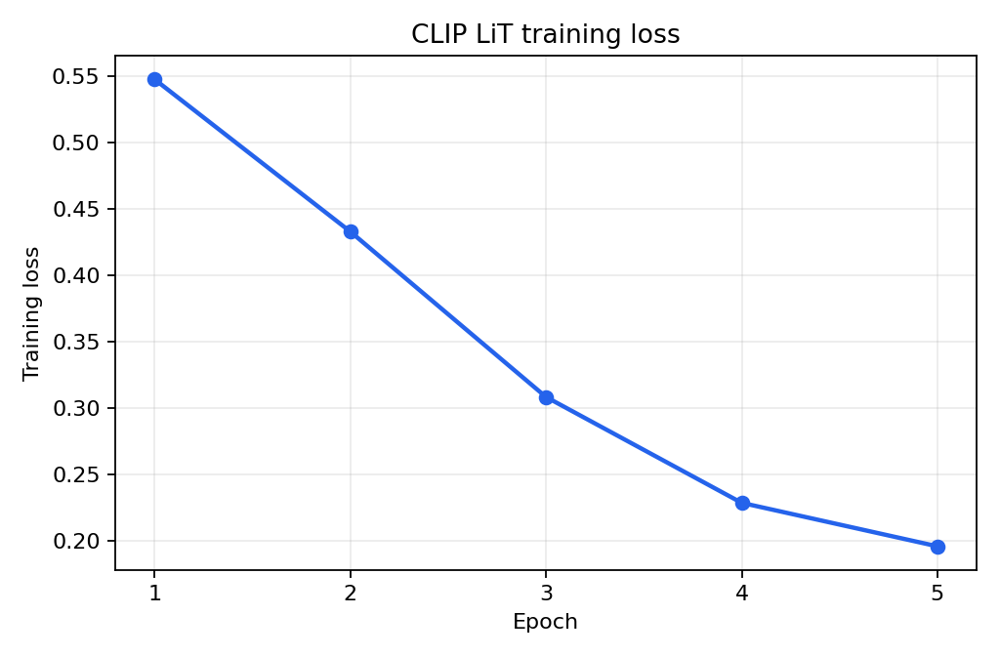

# clip LiT 自检报告

检查范围：Flickr val 前 500 张 clean 图片，每图第 1 条 caption。
设备：cuda；精度：fp32；提取 batch：32。

| 模态 | 余弦均值 | 标准差 | 最小值 | 最大值 |
|---|---:|---:|---:|---:|
| 图像 | 1.0000000000 | 0.0000000000 | 1.0000000000 | 1.0000000000 |
| 文本 | 0.7341315155 | 0.0482425829 | 0.5872797640 | 0.8573172914 |

图像检查：**通过**。要求每个样本的 1 − cosine ≤ 1e-05；超出容差 0/500 张。
图像原始嵌入最大绝对差：0。

训练记录来源：`/root/mmrep/ckpt/clip/lit/meta.json`。
训练 5 轮，batch 128；总耗时 279.06 秒，峰值显存 4180.89 MiB。
显存字段名为 gpu_mem_peak_MB，原代码实际按 2**20 换算；上述数值来自训练元数据，不是本次自检的资源开销。

[逐样本余弦](cosine.csv) · [每轮 loss 与耗时](epochs.csv) · [机器可读报告](report.json)

LiT checkpoint 只保存文本参数。本报告检查重载后图像侧一致性，不单独证明训练期间图像参数从未变化；需结合冻结测试。文本余弦仅作参照，不设置通过阈值。
